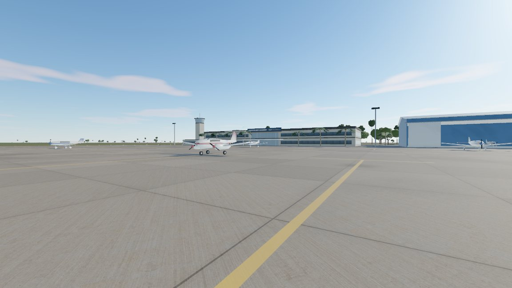
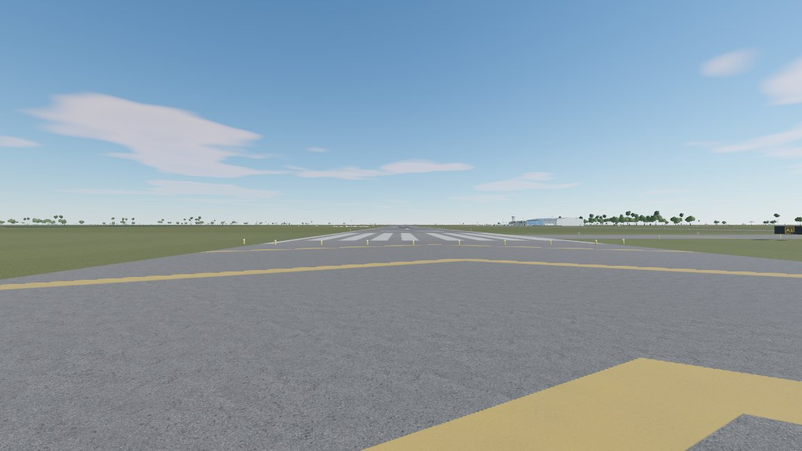
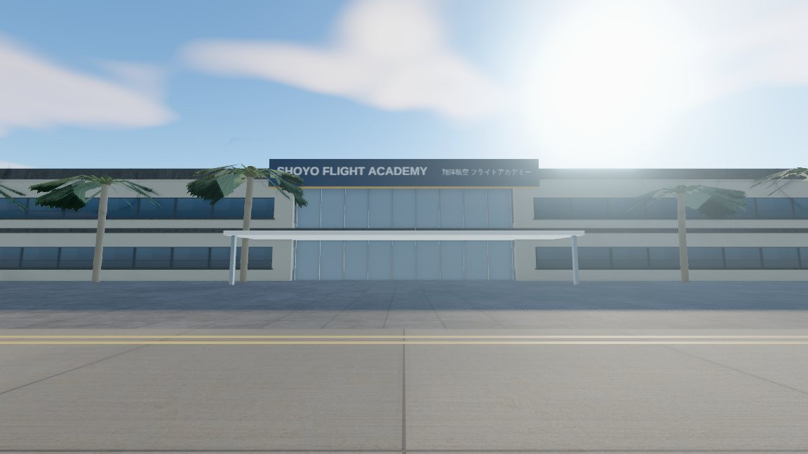
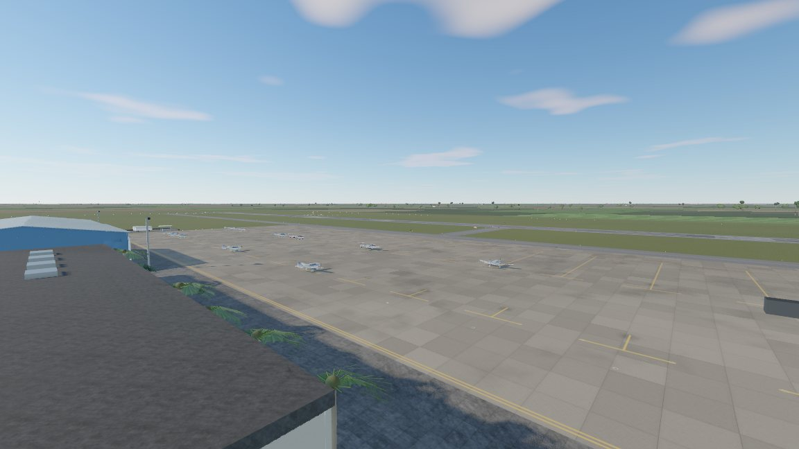
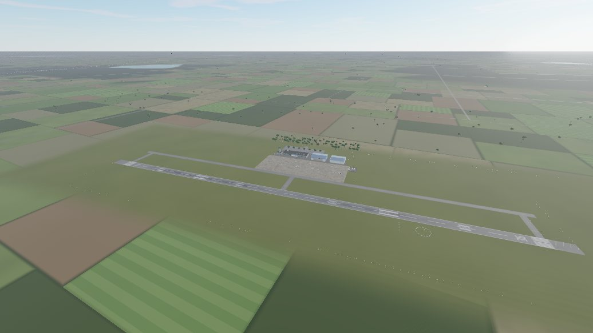
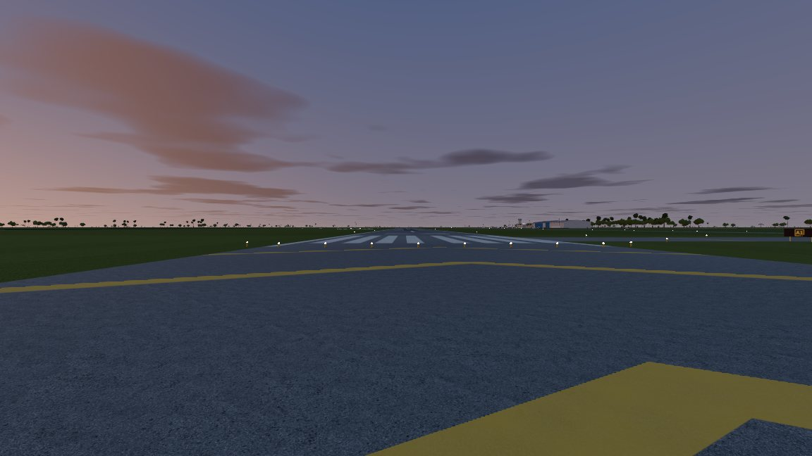

# CADET：パイロット訓練生シミュレーター

訓練生として訓練所で暮らし、歩いて、話して、点検して、乗って、飛ぶ。そういう一人称視点のゲームを作っています。計画は [`PLAN.md`](PLAN.md) にあります。

> 公開情報を基にした非公式のゲームです。航空会社・訓練所・人物はすべて架空です。実機訓練の代わりにはならず、航法にも使えません（NOT FOR NAVIGATION）。

## いまの段階：M0（土台）

[`outputs/CADET.html`](outputs/CADET.html) をダブルクリックすると Chrome で開きます。インストールは要らず、オフラインでも動きます。WebGL2 が必要です。

LAB 飛行場（FLIGHT LAB の架空の飛行場）を、見学用のカメラで自由に見て回れます。歩く・話す・飛ぶは、次の段階（M1〜M3）で作ります。

| 駐機場 | 滑走路 36 の端 | アカデミー |
|---|---|---|
|  |  |  |
| **管制塔から** | **上空から** | **夕暮れ** |
|  |  |  |

※ これらの画像は、GPU のないクラウド環境（ソフトウェア描画）で撮ったものです。実際の PC では、解像度がもっと高くなります。

### 入っているもの

**すべて FLIGHT LAB のデータから作っています**
- 滑走路・誘導路・エプロンは `FL.physics.PAVED` から作っています。見た目の舗装と、車輪が転がる舗装は完全に一致します（テストで確認済み）。
- 湖は `FL.physics.inLake` と同じ形です。
- 畑と道路の配置は FLIGHT LAB の外の景色に合わせ、林の位置も FLIGHT LAB と同じ乱数で並べています。
- 訓練空域の目印の塔（LAB-A〜F）と LAB VOR は `FL.avionics` の位置に置いています。
- 駐機場の Archer と Seminole は、物理モデルと同じ寸法から作った形（`FL.acmesh`）です。

**飛行場まわり**
- 滑走路の標示：末端標示・数字・接地帯・目標点・中心線・縁の線・ブラストパッドの矢羽根。FLIGHT LAB の着陸課目と同じ位置にあります。
- 誘導路まわり：中心線、取付誘導路から滑走路への導入線、停止線（実線 2 本と破線 2 本）。
- 標識（FAA の色）：停止位置標識、位置標識、方向標識、残り距離標識。
- 灯火と目視の装置：滑走路灯・末端灯・誘導路灯、PAPI（見る角度で白と赤が変わります）、風向きで動く吹き流しと、その周りの円。
- 駐機場の路面：コンクリートの目地と汚れ、駐機スポットの T 字、係留用のリング、油じみ、タイヤの跡。

**訓練所（すべて架空）**
- 格納庫 2 棟（1 棟は扉が開いていて、中に Archer があります）
- アカデミー棟（2 階建て、ガラス張りのロビー、名前の看板）
- 管制塔
- 給油所
- 照明塔
- 駐車場
- ヤシ・ライブオーク・マツ・低木

**画質**
- 物理ベースの描画です。トーンマッピングは AgX を使っています。
- 空は、時刻と季節で太陽の位置が正しく動きます。日没後は薄明の空になり、星が出ます。
- 太陽の影は、ちらつかないように調整しています。
- 空の光（IBL）を使っています。
- 距離と高さで変わる大気のかすみを入れています。
- 環境光の遮蔽（GTAO）と、明るい所のにじみ（ブルーム）を入れています。
- MSAA で輪郭のギザギザを減らしています。
- 塗装線と目地は、遠くでも太くならないように描いています。
- 画質は「低・中・高・最高」の 4 段階です。最初は GPU に合わせて自動で選び、そのあとフレーム時間に合わせて解像度を自動で調整します。

### 操作

| キー | 動き |
|---|---|
| クリック | 見回す（マウスの動きを使います。Esc で解除） |
| W A S D | 移動 |
| Shift | 速く |
| Space / C | 上へ / 下へ |
| G | 地面に立つ（目の高さ） |
| 1〜7 | 視点（駐機場・滑走路 36 の端・アカデミー・管制塔・ファイナル 2 km・上空・訓練空域） |
| [ / ] | 時刻を戻す / 進める |
| P | パネルを隠す |
| F | 計測の表示を切り替える |

### URL のオプション

| オプション | 意味 |
|---|---|
| `?q=low` / `medium` / `high` / `ultra` | 画質 |
| `?t=19.3` | 時刻 |
| `?view=3` | 最初の視点 |
| `?bench` | 7 つの視点で、それぞれの描画時間を計測する |
| `?auto` | 開始画面を飛ばす |

## 開発

```
cd cadet
npm install          # three（0.186.1）と esbuild（0.28.2）。版は固定です
npm run build        # outputs/CADET.html を作る（--dev で読みやすい版）
npm test             # ビルドとテスト 3 本
node test/shots.mjs ultra 1280 720 9.6     # 各視点のスクリーンショットを test-output/ に保存
```

テストは 3 本です。

- `layout`：見た目と FLIGHT LAB の物理が一致すること
  - 舗装・湖・座標の変換を確かめます。
  - 2 万点をランダムに選び、舗装が一致するか照合します。
- `build`：1 つのファイルで、外部への参照がないこと
  - 中のスクリプトがすべて構文として正しいことを確かめます。
  - 大きさが 15 MB 以内であることを確かめます。
- `browser`：ヘッドレスの Chromium で動くこと
  - `file://` で開き、通信をすべて止めた状態で起動します。
  - 7 つの視点のそれぞれで、絵が描けていることと、描画回数・三角形の数が予算内に収まることを確かめます。
  - 夕暮れ、画質の切り替え、計測も確かめます。

FLIGHT LAB のソースは `../flight-lab/src` から直接読み込みます（コピーしません）。FLIGHT LAB 側のテストもあわせて実行してください。

```
cd ../flight-lab && npm test   # 48 件
```

## フォルダ

```
src/main.js            起動と見学モード（M0）
src/world/             layout（FLIGHT LAB の数値からの配置・テスト対象）、ground、airfield、buildings、vegetation、landmarks
src/render/            post（描画の流れ）、sky（太陽・空・影）、materials、textures、glsl
src/aircraft/          exterior（acmesh から作る機体）
src/core/quality.js    画質の段階と、解像度の自動調整
src/ui/spectator.js    見学用のカメラ
assets/tex/            テクスチャ（CC0）。出典は assets/CREDITS.md
test/                  テストとスクリーンショットの道具
```
