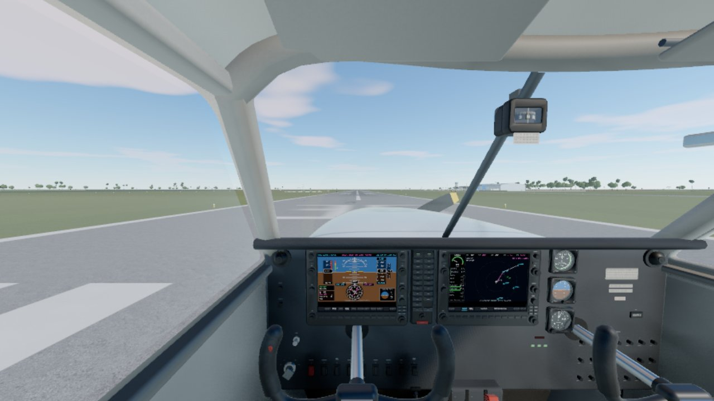
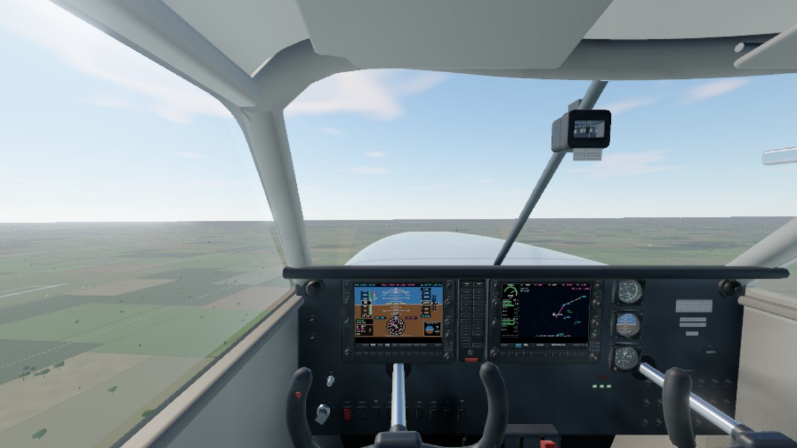
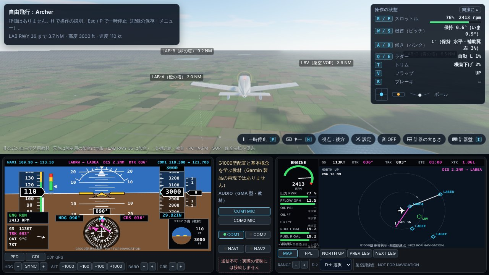
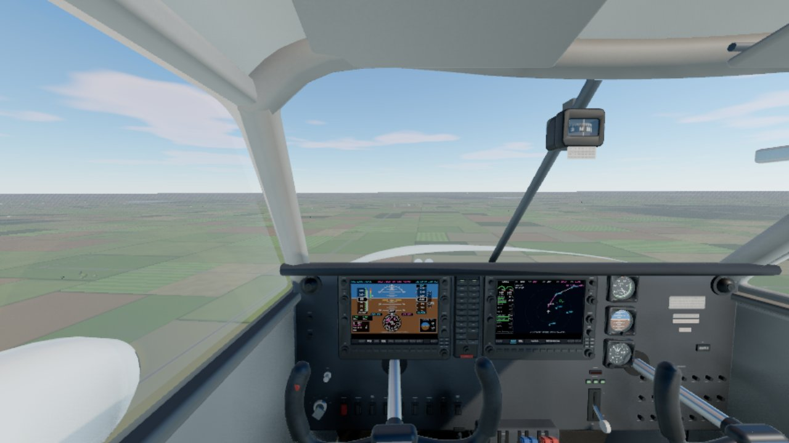
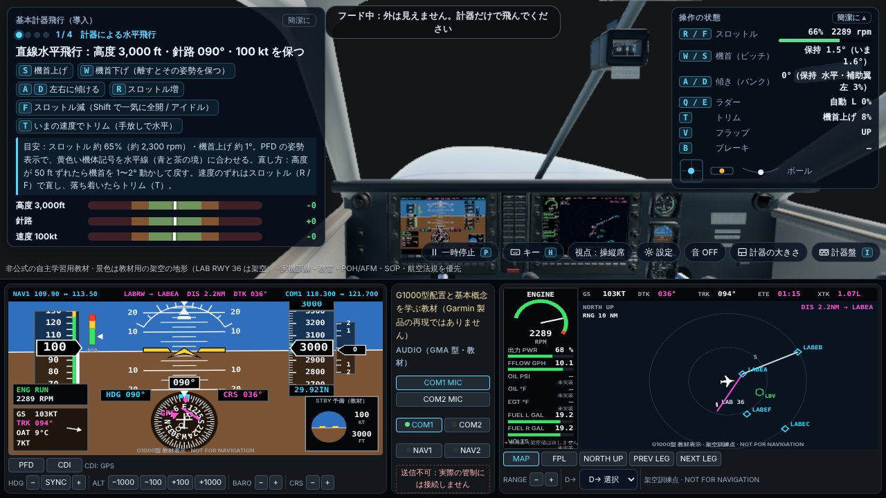
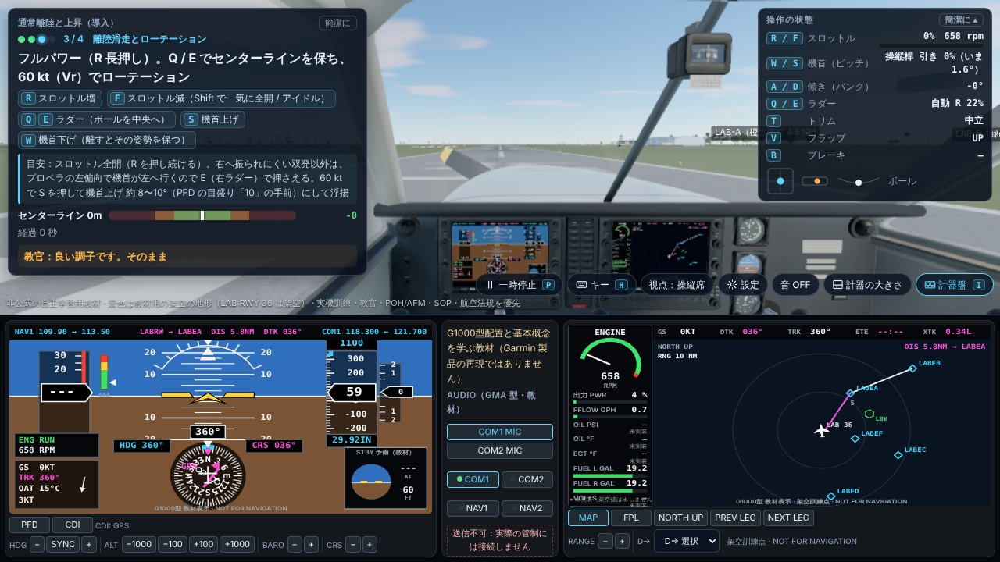
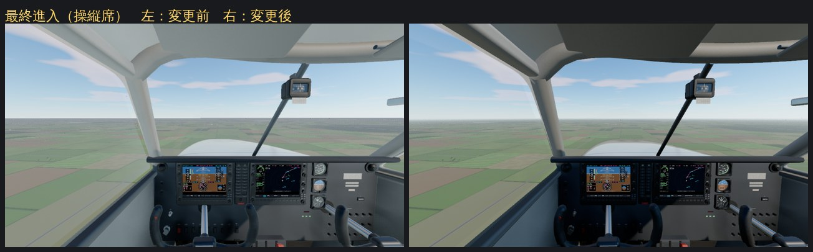
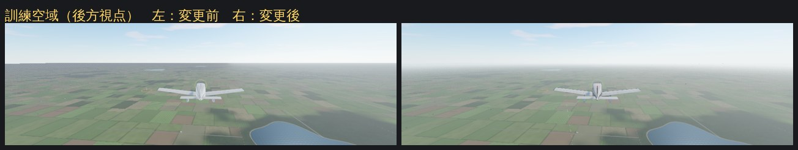
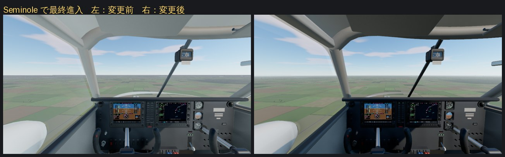

# FLIGHT LAB

公開情報を基にした**非公式の自主学習用**飛行訓練教材です。ブラウザで 1 ファイルを開くだけで動きます。

> 本アプリは公開情報を基にした非公式の自主学習用教材です。実機訓練、教官の指示、POH/AFM、SOP、航空法規を優先してください。
> ANA の公式ソフトウェアではなく、認定訓練装置でもありません。NOT FOR NAVIGATION。

| ファイル | 内容 |
|---|---|
| [`outputs/FLIGHT-LAB.html`](outputs/FLIGHT-LAB.html) | アプリ本体。ダブルクリックで Chrome で開きます（オフライン可） |
| [`outputs/FLIGHT-LAB-使い方.md`](outputs/FLIGHT-LAB-使い方.md) | 使い方（画面、すべてのキーの意味、33 課目と評価、教科書 27 章、英語交信の練習、記録、Google 3D） |
| [`outputs/ANA-SANFORD-調査と設計.md`](outputs/ANA-SANFORD-調査と設計.md) | 調査（事実・推測・未確認の区別）、設計、検証、未実装 |

v2：空島フライト（`../flight-sim.html`）の飛行モデル・操作・画面を移植し、教科書（23 章・102 節）、学科テスト（130 問）、飛行課目（33 課目 × 3 レベル）を拡充しました。

v2.1：無線交信を一から詳しくしました。教科書の交信の章を 5 章（しくみ・言葉の決まり・型と復唱・1 回の飛行の全交信・管制塔のない空港と緊急）に分けて書き直し（教科書は 27 章・120 節）、メニュー 06「英語交信（無線）」に 1 回の飛行の全交信（音声）、復唱と応答 41 場面、数字とアルファベットのドリル、聞き取り、用語集を追加。学科テストは 14 分野・145 問。

v2.2：飛行モデルの修正。垂直尾翼の横力（プロペラ後流・尾翼のオフセット）に「傾ける力」が抜けていたため、全開の上昇で左へ傾き続けていたのを直しました。キーボードの A / D に「離すとバンクを保つ」（標準）を追加。

v2.3：画面を作り直しました（ゲームの画面を参考に）。メニューは「続きから ▶ 飛ぶ」と大きな 4 つの入口、設定は別の画面。課程表は段階のタブと課目のカード（メダル・「次はこれ」）、開始ボタンは常に表示。飛行中は目標のゲージ・キーの絵・「簡潔に」表示。結果画面はメダルと「次に意識すること」。H でキーボードの絵（いま使うキーが光る）。最初に「はじめての方へ」。

v2.4：外部視界を姉妹作 CADET の three.js の景色（芝・舗装・建物・木・空）に替え、操縦席の視点を計器まで 3D の操縦席にしました（G1000 型の画面は操縦席の中に描かれ、「教材表示」「未実装」の注記も 2D の計器盤と同じ。キー・つまみ・フラップや脚のレバー・スロットル・トリムの輪をマウスで操作。ドラッグで見回し、右ボタンを押している間はマウスの所をズーム。灯火のスイッチは機体の外の灯りも点け消しします）。2D の計器盤は I キー・「計器盤」ボタンで出し入れでき、後方視点とフード中は自動で出ます。GPU のない PC（ソフトウェア描画）では自動で従来の軽い表示（「軽量」）を使い、⚙ 設定の「3D 表示」（自動・標準・軽量）と「画質」で切り替えられます（3D 表示の切り替えは読み込み直したあとに有効）。

| LAB RWY 36 の上（3D の操縦席） | 場周経路（ダウンウインド） | 訓練空域（後方視点） |
|---|---|---|
|  |  |  |
| **Seminole で最終進入** | **フード（課目 i1：窓の外は暗く、2D の計器盤が出る）** | **I キーで 2D の計器盤（課目 t1）** |
|  |  |  |

写真は GPU のない環境のソフトウェア描画（SwiftShader、画質「高」）で撮ったものです。描画の解像度が自動で下がるため、GPU のある PC で見るより粗く写っています。

v2.4 のあとで（光と大気、2026-10-26）：3D 表示の光を直しました（CADET と共有の描画の部品。詳しくは `../cadet/PLAN.md` の「M8 のあとで直したこと：光と大気」）。
- 遠くの地面が空の色に溶け込むようにしました。描画範囲の端で地面が灰色の帯になって切れていた、地平線の段差がなくなりました。
- 後方視点で画面を縦に切っていた明るさの境目（空がブルームのしきい値をまたいでいた）がなくなりました。
- 操縦席の天井や翼の下面など、下を向いた面は地面の照り返しの明るさになりました。風防にかかっていた白い膜も減りました。

v2.4 のあとで（操縦席の天井まわり、2026-10-26）：操縦席の天井の内張り・風防の上の枠・A ピラー・サンバイザーを、Blender で作った模型にしました（CADET と共有。詳しくは `../cadet/PLAN.md` の「M8 のあとで直したこと：操縦席の天井まわりを Blender で」）。
- 丸い管だった風防の枠とピラーが、風防の縁を包む成形品になり、風防との間に黒いゴムが見えます。
- 天井には縫い目と布のたるみ、サンバイザーには蝶番と留め金があります。
- 前と後の絵（左が前）は `docs/cockpit/`。

v2.4 のあとで（座席・グレアシールド・操縦輪、2026-10-26）：前の 2 席と後ろの席、グレアシールド、2 本の操縦輪も、Blender で作った模型にしました（CADET と共有。詳しくは `../cadet/PLAN.md` の「M8 のあとで直したこと：座席・グレアシールド・操縦輪を Blender で」）。
- 計器盤の上の縁が、縫い目のある丸いパッドになりました（前は薄い板の縁で、その下に灰色の線が見えていました）。
- 操縦輪は、管と箱ではなく、1 本につながった「羊の角」の形になりました。握りにはスイッチがあります。
- 予備の計器 3 つを 1 cm 左へ動かしました（右の操縦輪の軸がかかっていたため）。
- 前と後の絵（左が前）は `docs/cockpit/parts-*.jpg`。

v2.4 のあとで（本物の G1000 NXi の Archer に合わせる、2026-10-27）：Archer の操縦席を、本物の PA-28-181 Archer TX（G1000 NXi）の計器盤・スイッチ・色に合わせました（CADET と共有。詳しくは `../cadet/PLAN.md` の「本物の G1000 NXi の Archer TX に合わせる」）。
- 計器盤はつや消しの黒になりました。予備計器は、丸い計器 3 つから、パネルの左端の Garmin G5 1 台になりました（姿勢・速度・高度・方位を表示）。
- 右側には ELT のスイッチ・時間計・暖房と霜取りのレバーが、右下には 3 段のサーキットブレーカーが付きました。スロットルとミクスチャーは 2 本だけになり、キャブレター ヒートは右の別の溝になりました。
- スイッチは、本物と同じく窓の上の天井のパネルに並びます（パネルのスイッチの列と鍵はなくなりました）。
- 操縦輪は NXi の形（台形の台に Piper のシェブロン）、内装は明るいグレーです。
- Seminole は、共有している部分（黒い計器盤・G5・ブレーカーなど）だけが変わりました。
- 前と後の絵（左が前）は `docs/cockpit/nxi-01-04-07.jpg`。

v2.4 のあとで（壁・ドア・座席・床を本物の Archer TX に、2026-10-27）：横の壁・ドア・座席・床の中央の台も、本物の Archer TX に合わせました（CADET と共有。詳しくは `../cadet/PLAN.md` の「壁・ドア・座席と床を本物の Archer TX に」）。
- 窓の下で白と明るい灰色に分かれる壁、窓のまわりの縁、ひじ掛け・地図入れ・パイロットの小窓が付きました（Blender の模型）。
- 座席は、背とヘッドレストが一体の TX の形になりました。4 席とも 3 点式のシートベルトがあります。
- フラップのレバーは本物と同じく握りが前、トリムの輪はその後ろに、燃料セレクターは赤い取っ手と本物の目盛りになりました。
- 操縦席の下の縁の表（`src3d/scene3d.js` の `EDGE`。景色の名前の札を隠す範囲）を、新しい壁で測り直しました。

v2.4 のあとで（グレアシールドと計器盤の上の縁を本物の弓なりに、2026-10-30）：グレアシールドと計器盤の上の縁を、本物の Archer TX / Seminole NXi と同じ弓なりにしました（CADET と共有。詳しくは `../cadet/PLAN.md` の「グレアシールドと計器盤の上の縁を本物の弓なりに」）。
- 真ん中は平らなまま、両端が A ピラーに向かって 28 mm 下がります。計器盤の上の縁も同じだけ下がり、隅は横の壁の方へ少し向きを変えます。
- パッドの下には計器盤を照らす LED の帯、上面の風防の付け根には霜取りの吹き出し口が付きました。
- 下がった端と風防の下の縁（横一直線のまま）の間は、A ピラーの足元の部品（室内だけ）でふさいであります。
- 操縦席の下の縁の表（`src3d/scene3d.js` の `EDGE`）を、目からのレイで測り直しました。
- 前と後の絵（左が前）は `docs/cockpit/glare-*.jpg`。

左が前、右が後です。

開発：`npm ci`（three.js と esbuild。3D 表示の部品をまとめるのに必要）、`node build.mjs`（ビルド）、`node --test --test-concurrency=1 test/flight.test.mjs test/avionics.test.mjs test/browser.test.mjs`（テスト）。ブラウザのテストは 2 件：従来どおりの一巡（ソフトウェア描画なので「軽量」で動く）と、three.js の表示を強制した確認（`?render=three`・画質「低」。3D の部品のない版では省略）。
